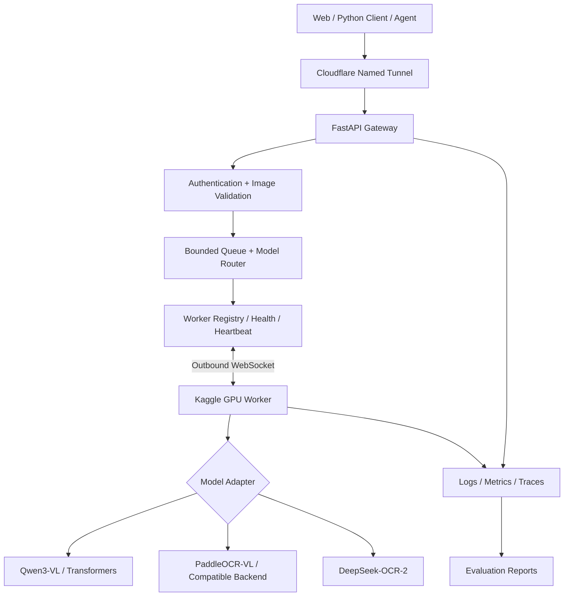

# KẾ HOẠCH TRIỂN KHAI VLM SERVING & EVALUATION

**Chủ đề:** From Kaggle GPU Experiments to Production-Ready Vision-Language Model Serving  
**Phiên bản:** 1.0  
**Ngày biên soạn:** 12/10/2026  
**Trạng thái:** Thiết kế / chưa triển khai và chưa có số liệu benchmark độc lập

> **Mục tiêu:** Xây dựng nền tảng phục vụ VLM qua API nhận ảnh + văn bản, đo chất lượng và hiệu năng, kiểm tra độ ổn định, tối ưu có bằng chứng, và chuyển từ Kaggle sang GPU server mà không cần thay đổi giao diện ứng dụng. **Kaggle chỉ dùng cho học tập/thử nghiệm trong quota và theo điều khoản của nền tảng; không xem là hạ tầng production 24/7.**

---

## Mục lục

1. [Tóm tắt điều hành](#1-tóm-tắt-điều-hành)
2. [Những phát hiện ảnh hưởng đến thiết kế](#2-những-phát-hiện-ảnh-hưởng-đến-thiết-kế)
3. [Nguồn GitHub và thành phần nên học](#3-nguồn-github-và-thành-phần-nên-học)
4. [Phạm vi và lựa chọn model](#4-phạm-vi-và-lựa-chọn-model)
5. [Kiến trúc hệ thống](#5-kiến-trúc-hệ-thống)
6. [Kế hoạch triển khai theo giai đoạn](#6-kế-hoạch-triển-khai-theo-giai-đoạn)
7. [Đánh giá định lượng](#7-đánh-giá-định-lượng)
8. [Đánh giá định tính](#8-đánh-giá-định-tính)
9. [Benchmark datasets](#9-benchmark-datasets)
10. [Thiết kế thí nghiệm và ablation](#10-thiết-kế-thí-nghiệm-và-ablation)
11. [Cấu trúc repository](#11-cấu-trúc-repository)
12. [API contract và mẫu dữ liệu](#12-api-contract-và-mẫu-dữ-liệu)
13. [Bảo mật, reliability và observability](#13-bảo-mật-reliability-và-observability)
14. [Rủi ro và quyết định kỹ thuật](#14-rủi-ro-và-quyết-định-kỹ-thuật)
15. [Definition of Done và checklist](#15-definition-of-done-và-checklist)
16. [Nguồn tham khảo](#16-nguồn-tham-khảo)

---

## 1. Tóm tắt điều hành

### 1.1. Bài toán

Triển khai Vision-Language Model (VLM) để người dùng gửi **ảnh + câu hỏi**, nhận **văn bản hoặc dữ liệu có cấu trúc** thông qua REST API tương thích kiểu OpenAI. Xem xét hai nhóm ứng dụng:

- **General VLM:** image question answering (VQA), scene understanding, image-grounded instruction following.
- **Document VLM/OCR:** đọc hóa đơn tiếng Việt, trích xuất trường, layout, bảng và xuất Markdown/JSON.

### 1.2. Nguyên tắc thiết kế

1. **Correctness before speed:** model phải đọc ảnh đúng trước khi tối ưu tokens/giây.
2. **Baseline trước tích hợp:** chạy được từng model trên cùng phần cứng trước khi thêm gateway, queue, tunnel.
3. **Transport độc lập inference engine:** Gateway không phụ thuộc vào Transformers, vLLM, SGLang hoặc PaddlePaddle.
4. **Một biến thay đổi mỗi lần:** mọi tối ưu đều có baseline, ablation, log và số liệu.
5. **Kaggle = experimental runtime:** phiên GPU có thể kết thúc bất kỳ lúc nào; không dựng giải pháp vượt quota hoặc duy trì server trái quy định.
6. **Production cần hạ tầng phù hợp:** chuyển worker sang GPU server được phép chạy dịch vụ liên tục, giữ nguyên API contract.

### 1.3. Phạm vi MVP đề xuất

| Thành phần | Lựa chọn ban đầu | Ghi chú |
|---|---|---|
| GPU thử nghiệm | Kaggle NVIDIA T4 × 2 (nếu được cấp) | Kiểm tra lại bằng `nvidia-smi` |
| Model baseline | Qwen3-VL-2B-Instruct | Dùng Transformers cho thử nghiệm khả thi ban đầu |
| Model đối chiếu | Qwen3-VL-4B-Instruct | Chỉ thêm sau khi 2B ổn định |
| Model document | PaddleOCR-VL-1.6-0.9B; DeepSeek-OCR-2 | Là một nhánh đánh giá riêng |
| Gateway | FastAPI + Pydantic | HTTP API, auth, validation |
| Worker transport | Outbound WebSocket | Worker Kaggle tự kết nối tới Gateway |
| Internet exposure | Cloudflare Named Tunnel hoặc giải pháp được kiểm soát | Xác thực bắt buộc |
| Evaluator | lmms-eval / VLMEvalKit + script custom | Chất lượng và hiệu năng phải đo riêng |
| Infrastructure về sau | Docker Compose + GPU worker | Không cần Kubernetes ở MVP |

**Không làm trong MVP:** Kubernetes, Ray cluster, multi-agent, multi-region orchestration, disaggregated prefill/decode hoặc hệ thống autoscaling phức tạp.

---

## 2. Những phát hiện ảnh hưởng đến thiết kế

### 2.1. `kaggle-host-llm` có Gateway/Worker tốt nhưng chưa là VLM tổng quát

Repository [sontungkieu/kaggle-host-llm](https://github.com/sontungkieu/kaggle-host-llm) mô tả Gateway chạy ngoài Kaggle; notebook mở **outbound WebSocket** tới `/workers/connect`, đăng ký worker, nhận job và gửi kết quả qua Gateway. Đây là kiến trúc tốt để tham khảo control plane.

Tuy nhiên, cần **kiểm tra và mở rộng contract multimodal**; không được giả định đường chat worker hiện có tiếp nhận ảnh và video đầy đủ chỉ vì repo đã có các tác vụ OCR. Phải bổ sung validation, serialization và model adapter xử lý `image_url`/base64 thực tế.

### 2.2. T4 giới hạn lựa chọn serving backend

NVIDIA T4 có Compute Capability 7.5. Trong tài liệu PaddleOCR-VL, các đường chạy PaddlePaddle/Transformers hỗ trợ CC >= 7.0, còn đường vLLM, SGLang và FastDeploy được khuyến nghị yêu cầu CC >= 8.0; vLLM trên T4 có thể gặp OOM/timeout và **không được khuyến nghị**. Vì vậy:

- Chạy smoke test **PaddleOCR-VL bằng backend tương thích T4** trước.
- Không hard-code vLLM làm runtime duy nhất.
- Không cài mọi backend vào một môi trường Python vì có thể xung đột dependency.
- Đo bộ nhớ ảnh đầu vào và context, không chỉ kích thước weights.

Nguồn: [PaddleOCR-VL Official Documentation](https://www.paddleocr.ai/main/en/version3.x/pipeline_usage/PaddleOCR-VL.html).

### 2.3. Không so sánh repo bằng benchmark không đồng nhất

Tốc độ từ hai repo chạy model khác nhau, lượng tử hóa khác nhau, prompt khác nhau hoặc concurrency khác nhau **không so sánh trực tiếp được**. Mọi kết luận phải dựa trên cùng checkpoint/model configuration, cùng workload, cùng GPU, cùng điều kiện client và cùng định nghĩa metric.

---

## 3. Nguồn GitHub và thành phần nên học

| Dự án / tài liệu | Ý tưởng học và kế thừa | Sử dụng ở pha |
|---|---|---|
| [kaggle-host-llm](https://github.com/sontungkieu/kaggle-host-llm) | FastAPI Gateway, reverse WebSocket, registry, heartbeat, timeout | 2 |
| [KaggleInferenceServer](https://github.com/Nasus20202/KaggleInferenceServer) | CLI, quản lý phiên, local proxy, benchmark, khôi phục kết nối, inference qua llama.cpp | 2–4 |
| [vLLM](https://github.com/vllm-project/vllm) | OpenAI-compatible multimodal serving, batching, scheduler, metrics | 4–5 khi tương thích |
| [Qwen3-VL](https://github.com/QwenLM/Qwen3-VL) | Model/processor cho image-text, recipe và cấu hình inference | 0–1 |
| [PaddleOCR](https://github.com/PaddlePaddle/PaddleOCR) | Document parsing, layout và VLM OCR pipeline | 0, 3 |
| [lmms-eval](https://github.com/EvolvingLMMs-Lab/lmms-eval) | Multimodal benchmarking, task adapter, custom eval | 3 |
| [VLMEvalKit](https://github.com/open-compass/VLMEvalKit) | Khung so sánh và benchmark VLM độc lập | 3 |
| [Ray Serve](https://github.com/ray-project/ray) | Tham khảo scale và inference deployment trên GPU server | 5 nếu cần |

**Quy tắc dùng lại:** đọc source và license, chỉ trích xuất pattern/adapter cần thiết; lưu lý do và commit/version trong `docs/decision_log.md`.

---

## 4. Phạm vi và lựa chọn model

| Model ứng viên | Use case | Điều kiện tham gia benchmark |
|---|---|---|
| Qwen3-VL-2B-Instruct | General VQA, mô tả ảnh, OCR cơ bản | Chạy được trên Kaggle T4, ghi rõ revision và dtype |
| Qwen3-VL-4B-Instruct | Kiểm tra speed–quality trade-off | Cùng test set và cùng logic tiền xử lý |
| PaddleOCR-VL-1.6-0.9B | Tài liệu/hóa đơn, layout, bảng | Xác minh đường inference tương thích T4 |
| DeepSeek-OCR-2 | Document OCR, xuất text/Markdown | Xác minh resource requirement và worker end-to-end |

**Baseline:** Qwen3-VL-2B-Instruct + Transformers + `batch_size=1`, prompt ngắn, nhiệt độ sinh văn bản cố định (ưu tiên deterministic khi cần benchmark correctness).

**Lưu ý:** VLM chung và hệ OCR tài liệu trả kết quả khác nhau. Chất lượng nên báo cáo theo từng tác vụ; không suy diễn một điểm tổng hợp là model tốt nhất cho mọi mục đích.

---

## 5. Kiến trúc hệ thống



> **Triển khai MVP:** các model adapters chạy lần lượt hoặc theo năng lực VRAM; không giả định cả ba model nạp đồng thời. Worker kết nối ra Gateway; không cần inbound networking trên Kaggle.

### 5.1. Các component

**Gateway:**
- OpenAI-compatible `/v1/chat/completions` cho image + text ở phạm vi hỗ trợ.
- `/v1/models`, `/health`, request ID và structured errors.
- Auth, schema validation, MIME/pixel limit, safe URL handling.
- Queue có giới hạn; timeout và hủy job hợp lý.
- Không giữ raw ảnh nhạy cảm trong log.

**Worker Runtime:**
- Chủ động kết nối, register, heartbeat, reconnect có exponential backoff + jitter.
- Chuẩn hóa preprocessing/postprocessing.
- Báo `ready`, `busy`, `unhealthy`, `unavailable`.
- Giới hạn concurrency theo VRAM; cleanup GPU memory nếu cần.

**Model Adapter:**
- `load_model(config)`, `infer(request)`, `unload()`, `health()`.
- `model_id`, revision, dtype, quantization, device mapping.
- Chuẩn hóa response text/JSON/Markdown theo capability.

**Evaluation:**
- Chạy benchmark local worker và qua Gateway theo cùng input.
- Lưu `request_id`, time breakdown, phần cứng, kết quả, nhãn đúng, metric.
- Tách đo correctness khỏi đo performance.

---

## 6. Kế hoạch triển khai theo giai đoạn

### Phase 0 — Feasibility: phần cứng, model và backend

**Việc làm:**
1. Tạo Kaggle notebook, bật GPU và Internet theo cấu hình được phép.
2. Ghi `nvidia-smi`, driver, CUDA runtime, Python/PyTorch, bộ nhớ GPU và quota được báo tại thời điểm chạy.
3. Chạy Qwen3-VL-2B bằng Transformers với 20 ảnh đa dạng.
4. Đo peak VRAM, latency, trường hợp lỗi.
5. Thử riêng PaddleOCR-VL-1.6 và DeepSeek-OCR-2 (không ép dùng engine không tương thích).

**Deliverables:** `notebooks/kaggle_worker.ipynb`, `reports/hardware_report.json`, `docs/backend_compatibility.md`.

**Exit criteria:** ít nhất một VLM thật nhận ảnh + text, trả lời hợp lệ ≥20 smoke cases; lỗi/OOM được ghi lại chứ không che giấu.

### Phase 1 — Serving một VLM

**Việc làm:** xây adapter, API tối thiểu, xử lý ảnh base64 hoặc URL được phép; Pydantic schemas; test tình huống ảnh lỗi, kích thước vượt giới hạn, model chưa sẵn sàng.

**Deliverables:** worker runtime, API contract, README quickstart, smoke tests.

**Exit criteria:** chạy request bằng Python client, trả kết quả tương ứng với inference trực tiếp; logs có request ID.

### Phase 2 — Gateway + Tunnel + remote worker

**Việc làm:** học gateway từ `kaggle-host-llm`, triển khai WebSocket outbound, registry, status và auth; thiết lập Cloudflare Tunnel; đo overhead từng layer; bảo vệ URL endpoint và API key.

**Deliverables:** Gateway Docker Compose, worker config, script kết nối, integration tests, fault-injection scripts.

**Exit criteria:** client ở máy khác gửi ảnh thành công; worker offline trả lỗi rõ; reconnect không sinh job trùng nguy hiểm.

### Phase 3 — Benchmark chất lượng và performance

**Việc làm:** tích hợp datasets, script benchmark, lmms-eval/VLMEvalKit nếu phù hợp; tự chấm field extraction; kiểm tra thủ công ít nhất 50 trường hợp.

**Deliverables:** `evaluation/results/*.jsonl`, `evaluation/reports/*.md`, CSV summaries, plots.

**Exit criteria:** thí nghiệm tái lập được; có bảng số liệu và phân tích failure cases, không dùng số liệu minh họa làm kết quả thật.

### Phase 4 — Tối ưu và ablation

**Thử theo thứ tự:** ảnh resize -> batching/concurrency -> quantization -> worker scheduling -> caching/retry; mỗi thay đổi tối thiểu một baseline so sánh có kiểm soát.

**Deliverables:** `reports/ablation.md`, Pareto chart, cấu hình được chọn cho từng use case.

**Exit criteria:** chỉ áp dụng tối ưu có lợi theo mục tiêu đã định và không gây suy giảm chất lượng không được chấp nhận.

### Phase 5 — Chuyển production GPU server

**Việc làm:** chuyển worker khỏi Kaggle sang môi trường compute được phép vận hành lâu dài; Docker GPU runtime; monitoring; secrets; load tests; backup/restore cấu hình; health/restart/rollback.

**Deliverables:** `infra/docker/`, deployment runbook, SLO report, CI/CD và cấu hình staging/prod.

**Exit criteria:** Client/Gateway vẫn dùng cùng contract khi thay GPU backend; đáp ứng SLO đo bằng load tests theo điều kiện triển khai thật.

---

## 7. Đánh giá định lượng

### 7.1. Nhóm Quality

| Metric | Định nghĩa / cách dùng | Lưu ý |
|---|---|---|
| CER | Character Error Rate cho OCR | Ghi rõ normalize Unicode và dấu tiếng Việt |
| WER | Word Error Rate | Tokenization tiếng Việt phải nhất quán |
| Exact Match | Câu trả lời trùng đáp án chuẩn | Có thể quá khắt khe với câu diễn đạt khác |
| ANLS | Tương đồng câu trả lời VQA | Dùng khi benchmark quy định |
| Field Accuracy / F1 | Trường hóa đơn: tổng tiền, ngày, nhà bán hàng… | Chấm riêng từng field và overall |
| JSON Validity | Tỷ lệ JSON hợp lệ và đúng schema | Không đồng nghĩa dữ liệu chính xác |
| Hallucinated-field Rate | Tỷ lệ trường model bịa khi ảnh thiếu thông tin | Nên thêm test thông tin che khuất |
| Human Rating | Điểm chuyên gia theo rubric | Chấm blind, lưu bất đồng người chấm |

### 7.2. Nhóm Serving Performance

| Metric | Cách đo | Đơn vị |
|---|---|---|
| E2E Latency p50/p95/p99 | Từ khi client gửi đến khi nhận kết quả cuối | ms hoặc s |
| TTFT p50/p95 | Thời gian đến token đầu (nếu streaming) | ms |
| TPOT | Thời gian trung bình/token sau token đầu | ms/token |
| Request Throughput | Completed successful requests / elapsed time | req/s |
| Output Throughput | Total generated output tokens / elapsed time | tok/s |
| Goodput | Request đạt ngưỡng SLO / elapsed time | req/s |
| Error Rate | Failed requests / attempted requests | % |
| Peak VRAM | GPU memory peak từng kịch bản | MiB/GiB |
| Cold Start | Thời gian boot + download/load model đến ready | s |
| Recovery Time | Từ worker lỗi đến lúc nhận job ổn định | s |

**Công thức:**

\[
\mathrm{ErrorRate}=\frac{N_{failed}}{N_{attempted}}\times 100\%.
\]

\[
\mathrm{Throughput}=\frac{N_{completed}}{T_{elapsed}},\quad
\mathrm{OutputTokensPerSecond}=\frac{\sum N_{out\ tokens}}{T_{elapsed}}.
\]

**Phải tách:** model compute latency / preprocessing / queue waiting / Gateway + Tunnel network overhead / client total time.

### 7.3. Nhóm Operational Cost

- GPU-seconds trên mỗi request và mỗi ảnh thành công.
- Peak VRAM và utilization khi concurrency thay đổi.
- Thời gian warm-up, tải model, khôi phục worker.
- Chi phí tiền mặt khi chuyển sang GPU trả phí, cộng điện/máy Gateway và công vận hành.

Không tuyên bố “chi phí bằng 0” theo nghĩa toàn hệ thống: Kaggle miễn phí **trong quota**, nhưng GPU-hours, setup và Gateway vẫn có chi phí cơ hội/vận hành.

---

## 8. Đánh giá định tính

### 8.1. Code & Architecture Review (rubric 1–5)

| Tiêu chí | Câu hỏi đánh giá | Bằng chứng cần lưu |
|---|---|---|
| Architecture | Có tách contract, gateway, transport, adapter? | Sơ đồ + source references |
| Security | Có auth, giới hạn ảnh, bảo vệ URL, secrets? | Security tests + code review |
| Reliability | Worker ngắt giữa job có được xử lý không? | Fault-injection logs |
| Maintainability | Tests, lint, type hints, README, config? | CI report |
| Portability | Chuyển Kaggle → GPU server có sửa client? | Deployment test |
| Observability | Có metrics, request ID, lỗi có ngữ cảnh? | Trace/log examples |
| User Experience | Kết quả dễ hiểu, lỗi minh bạch, feedback? | UX scenarios |

**Thang gợi ý:** 1 = thiếu nghiêm trọng; 2 = có nhưng khó dùng; 3 = mức tối thiểu hoạt động; 4 = khá tốt và có test; 5 = đầy đủ, kiểm chứng và dễ vận hành. Không chấm điểm không kèm chứng cứ.

### 8.2. Human Evaluation của VLM

Chọn 50–100 mẫu phân tầng theo độ khó; ít nhất hai người chấm độc lập (nếu nguồn lực cho phép), ẩn model name khi đánh giá. Các tiêu chí:

1. Đúng nội dung nhìn thấy trong ảnh.
2. Đầy đủ thông tin được yêu cầu.
3. Không suy diễn giá trị không quan sát được.
4. Tiếng Việt rõ ràng, đúng dấu.
5. Làm đúng định dạng Markdown/JSON được yêu cầu.

Lưu `sample_id`, chú thích, điểm từng tiêu chí, nhãn lỗi, mức nhất trí hai người chấm. Với dữ liệu có nhãn phân loại, cân nhắc Cohen's Kappa; điểm rubric ordinal dùng weighted Kappa phù hợp hơn nếu cần.

### 8.3. Error taxonomy

- Bỏ sót chữ; sai dấu tiếng Việt; nhầm số `0/O`, `1/l`.
- Đọc sai hàng/cột bảng, sai layout, đảo thứ tự đọc.
- Nhầm tổng tiền với VAT/tạm tính; sai ngày/đơn vị tiền tệ.
- Hallucination đối với phần bị mờ/khuất.
- Lỗi do image resize/crop, giới hạn độ phân giải.
- JSON parse/schema error; transport timeout; GPU OOM.

---

## 9. Benchmark datasets

| Nguồn | Dùng cho | Ghi chú |
|---|---|---|
| [ViTextVQA](https://github.com/minhquan6203/ViTextVQA-Dataset) | Vietnamese text-centric visual question answering | Kiểm tra quyền truy cập, splits, license |
| [MDPBench](https://github.com/Yuliang-Liu/MultimodalOCR/tree/main/MDPBench) | Multilingual document parsing, có tiếng Việt | 3.400 ảnh, 17 ngôn ngữ theo công bố nhóm tác giả |
| [OCRBench v2](https://github.com/Yuliang-Liu/MultimodalOCR/tree/main/OCRBench_v2) | OCR trong ảnh, hóa đơn, biểu đồ, tài liệu | 10.000 human-verified QA, nhiều dạng tác vụ |
| [DocVQA 2026](https://github.com/VLR-CVC/DocVQA2026) | Document VQA, reasoning, evaluation scripts | Không giả định private test labels công khai |
| `Vietnamese-Invoice-Gold` (tự xây) | Trích xuất hóa đơn Việt Nam | 200–300 ảnh được phép sử dụng, ẩn danh |

### 9.1. Bộ hóa đơn riêng cần có nhãn

Schema tham khảo:

```json
{
  "sample_id": "invoice_0001",
  "image_path": "images/invoice_0001.png",
  "split": "test",
  "ground_truth": {
    "seller_name": "...",
    "invoice_number": "...",
    "invoice_date": "YYYY-MM-DD",
    "subtotal": null,
    "tax_amount": null,
    "total_amount": 0,
    "currency": "VND",
    "items": []
  },
  "quality_tags": ["photographed", "low-light"]
}
```

**Trước khi đánh giá:** phải chốt normalization cho tiền, dấu phân cách hàng nghìn, ngày, Unicode NFC, trường thiếu/null, JSON schema và tiêu chí partial match.

**Chống leakage:** giữ dataset test cố định và không tối ưu prompt liên tục trên test set; tách dev/test.

---

## 10. Thiết kế thí nghiệm và ablation

### 10.1. Các thí nghiệm chính

| ID | Cấu hình A | Cấu hình B | Câu hỏi nghiên cứu |
|---|---|---|---|
| E1 | Worker local direct API | Gateway + Tunnel | Gateway/network thêm bao nhiêu latency? |
| E2 | Qwen3-VL-2B | Qwen3-VL-4B | Quality cải thiện bao nhiêu so với latency/VRAM? |
| E3 | Image original | Resize/crop chính sách cố định | Tốc độ/độ chính xác thay đổi thế nào? |
| E4 | FP16/BF16 nếu hỗ trợ | Quantized compatible | Tiết kiệm VRAM có giảm chất lượng? |
| E5 | Concurrency 1 | 2/4/8/16 (nếu VRAM cho phép) | Điểm bão hòa throughput? |
| E6 | Worker hoạt động bình thường | Kill/restart/disconnect | Recovery và error handling ra sao? |
| E7 | Một GPU/replica | Hai GPU theo thiết kế hợp lệ | Replica vs parallelism có lợi khi nào? |

### 10.2. Protocol kiểm thử

- Lưu phần cứng, model ID/revision, driver, CUDA, package versions, quantization, context, image preprocessing.
- Giữ cùng input set, sampling settings, output limits và client location cho mỗi cặp so sánh.
- Warm-up trước benchmark; chạy ít nhất 3 lần ở mỗi cấu hình để có phân bố sơ bộ.
- Đo p50/p95; chỉ báo cáo p99 khi số mẫu đủ lớn và có độ tin cậy.
- Giữ cả request lỗi/timeout trong mẫu số error rate.
- Có nhóm ảnh dễ, khó, nghiêng, mờ, độ phân giải cao; báo cáo theo strata.
- Tách benchmark correctness khỏi load testing để tránh độ nhiễu do GPU tranh chấp.
- Gắn confidence interval khi có đủ mẫu; không kết luận thắng chỉ vì chênh lệch nhỏ ở một lần chạy.

### 10.3. Workload gợi ý

| Workload | Ảnh | Prompt | Output max | Concurrency |
|---|---|---|---|---|
| Image QA | 1 | Ngắn | 128 tokens | 1, 2, 4, 8 |
| Document QA | 1 | Trung bình | 256 tokens | 1, 2, 4 |
| Invoice extraction | 1 | JSON schema | 512 tokens | 1, 2, 4 |
| Multi-image reasoning | 2–3 | Ngắn | 256 tokens | 1, 2 (nếu hỗ trợ) |
| Fault injection | 1 | Ngắn | 128 tokens | 2, 4 |

**Lưu ý:** Đây là workload khởi đầu, không phải khẳng định T4 chạy được mọi mức concurrency. Điều chỉnh sau Phase 0.

### 10.4. Mẫu bảng kết quả cuối cùng

| Model | Backend | Quality metric | p95 E2E (s) | Throughput (req/s) | Peak VRAM (GiB) | Error rate |
|---|---|---:|---:|---:|---:|---:|
| Qwen3-VL-2B | Transformers | TBD | TBD | TBD | TBD | TBD |
| Qwen3-VL-4B | Compatible backend | TBD | TBD | TBD | TBD | TBD |
| PaddleOCR-VL-1.6 | Compatible backend | TBD | TBD | TBD | TBD | TBD |
| DeepSeek-OCR-2 | Compatible backend | TBD | TBD | TBD | TBD | TBD |

**`TBD` nghĩa là chưa chạy benchmark; không được tự điền số giả.**

---

## 11. Cấu trúc repository

```text
vlm-serving-platform/
├── apps/
│   ├── gateway/                   # FastAPI + routes + auth
│   └── web/                       # Tùy chọn: image upload & compare UI
├── packages/
│   ├── contracts/                 # Pydantic request/response/event schemas
│   ├── worker_runtime/            # WebSocket, heartbeat, retry, task execution
│   ├── model_adapters/
│   │   ├── qwen_vl.py
│   │   ├── paddleocr_vl.py
│   │   └── deepseek_ocr.py
│   ├── image_processing/          # decode, validate, resize, safety
│   └── telemetry/                 # logs, metrics, traces
├── notebooks/
│   └── kaggle_worker.ipynb        # Thin bootstrap, không nhét business logic
├── evaluation/
│   ├── datasets/
│   ├── quality/
│   ├── performance/
│   ├── qualitative/
│   ├── reports/
│   └── results/
├── configs/
│   ├── models/
│   └── environments/
├── infra/
│   ├── docker/
│   └── cloudflare/
├── tests/
│   ├── unit/
│   ├── integration/
│   └── fault_injection/
├── docs/
│   ├── architecture.md
│   ├── api_contract.md
│   ├── benchmark_protocol.md
│   ├── backend_compatibility.md
│   ├── decision_log.md
│   └── deployment_runbook.md
├── pyproject.toml
└── README.md
```

### Mô hình luồng dữ liệu

`Client → Gateway → validate request → bounded queue → worker registry → outbound WebSocket → VLM adapter → response → metrics/evaluation`.

---

## 12. API contract và mẫu dữ liệu

### 12.1. Request (multimodal chat)

Ví dụ **schema hướng tới** OpenAI-style, không khẳng định repo nền tảng đã hỗ trợ đầy đủ:

```json
{
  "model": "qwen3-vl-2b",
  "messages": [
    {
      "role": "user",
      "content": [
        {"type": "text", "text": "Đọc tổng tiền trên hóa đơn."},
        {"type": "image_url", "image_url": {"url": "data:image/png;base64,<base64>"}}
      ]
    }
  ],
  "max_tokens": 256,
  "temperature": 0
}
```

### 12.2. Response cho field extraction

```json
{
  "request_id": "req_example",
  "model": "paddleocr-vl-1.6",
  "status": "completed",
  "data": {
    "seller_name": null,
    "invoice_date": null,
    "total_amount": null,
    "currency": "VND"
  },
  "usage": {
    "input_tokens": null,
    "output_tokens": null
  }
}
```

**Nguyên tắc:** `null` cho thông tin không đọc được; không tự suy đoán số tiền. Chỉ trả `usage` khi adapter đo/ước lượng theo định nghĩa ghi rõ. Hệ thống cần `capabilities` để biết model hỗ trợ image-chat, markdown OCR, JSON extraction, streaming hay batch.

### 12.3. Evaluation JSONL

```json
{"sample_id":"invoice_0001","model":"qwen3-vl-2b","backend":"transformers","run_id":"run_001","latency_ms":0,"success":true,"prediction":{},"ground_truth":{},"error_type":null}
```

*Các con số ở đây chỉ minh họa schema, không phải benchmark.*

---

## 13. Bảo mật, reliability và observability

### 13.1. Security checklist

- API token bắt buộc khi endpoint có thể truy cập từ Internet; không để mặc định rỗng.
- Hạn chế kích thước ảnh (byte/pixel), số ảnh/request, MIME, ảnh lỗi/decompression bomb.
- Không cho tải URL ảnh tùy ý; dùng allowlist hoặc fetch proxy phòng SSRF; cấm loopback/private IP, redirect không kiểm soát.
- Giới hạn concurrency, request rate, max output tokens; từ chối hợp lý khi quá tải.
- Secrets nằm trong environment/secret manager; không commit vào notebook, logs hay GitHub.
- Không log ảnh hóa đơn hay thông tin cá nhân thô; xóa dữ liệu tạm đúng hạn.
- Cập nhật dependency và ghi SBOM/versions khi triển khai production.

### 13.2. Reliability checklist

- Worker heartbeat TTL + trạng thái hết phiên; reconnect backoff/jitter.
- Job timeout, cancellation, idempotency key và quy tắc retry rõ ràng.
- Queue bounded, trả `429`/`503` khi quá tải hoặc không có worker; không xếp hàng vô hạn.
- Health endpoint tách `liveness` và `readiness`.
- Fault injection: kill worker, mất WebSocket, Gateway restart, OOM, malformed image.

### 13.3. Metrics và logs

- Mỗi request một `request_id` xuyên suốt Gateway–Worker.
- Log JSON: timestamp, model, status, latency breakdown, size/count ảnh, error type.
- Prometheus metrics ở Gateway/Worker; Grafana tùy chọn.
- Đo queue wait, inference, preprocessing, network, TTFT/E2E, GPU VRAM và success/error.
- Định nghĩa SLO **sau khi có baseline**; không hứa các ngưỡng tùy ý trước thử nghiệm.

---

## 14. Rủi ro và quyết định kỹ thuật

| Rủi ro | Tác động | Hành động |
|---|---|---|
| Kaggle hết quota hoặc kết thúc session | Worker mất kết nối | Coi là môi trường thử nghiệm; Gateway phản hồi rõ, không circumvent limits |
| T4 thiếu VRAM/CC | Model không chạy, OOM | Test feasibility, chọn backend phù hợp, giảm image size và context |
| Dependency xung đột | Setup khó tái lập | Lock version; environment riêng theo backend |
| Tunnel/Internet bất ổn | E2E latency tăng, timeout | Measure direct vs tunnel, retry an toàn, bounded timeout |
| VLM suy diễn giá trị | Sai hóa đơn | Test hallucination, dùng null/abstain và human review |
| Benchmark sai lệch | Kết luận không đáng tin | Same hardware, paired dataset, repeats, publish config |
| Chi phí có vẻ miễn phí | Khó mở rộng thực tế | Dự toán GPU server + vận hành khi production |
| Dữ liệu hóa đơn nhạy cảm | Rủi ro riêng tư | Ẩn danh, hạn chế lưu trữ, kiểm soát quyền truy cập |

### Decision log ban đầu

| Quyết định | Lý do |
|---|---|
| Transformers làm baseline ban đầu | Đơn giản, xác minh correctness và compatibility trước |
| Tách model adapters khỏi Gateway | Dễ thay runtime và GPU provider |
| Không cài Ray/K8s ở MVP | Tránh hạ tầng phức tạp chưa có bottleneck |
| Tách general VLM và document OCR benchmark | Output format/metric không hoàn toàn tương đương |
| Bắt buộc có evaluation từ Phase 0 | Đảm bảo kiến trúc/optimization dựa trên bằng chứng |

---

## 15. Definition of Done và checklist

### Phase checklist

- [x] P0: GPU, driver, versions được ghi lại.
- [x] P0: Qwen3-VL-2B inference thành công với ảnh thật, có log VRAM.
- [x] P0: Bảng tương thích PaddleOCR-VL/DeepSeek-OCR-2 trên T4.
- [x] P1: API nhận ảnh + text và trả response chuẩn hóa.
- [x] P1: Unit tests validation, lỗi input, model readiness.
- [x] P2: Gateway/WebSocket/Cloudflare hoạt động cho demo xác thực.
- [x] P2: Test worker offline/reconnect/timeout/queue full.
- [x] P3: Quality benchmark trên dataset public và hóa đơn VN.
- [x] P3: Performance benchmark đo p50/p95, throughput, VRAM, error rate.
- [x] P3: Blind qualitative evaluation + failure taxonomy.
- [x] P4: Có ablation trước/sau các tối ưu.
- [x] P4: Chốt trade-off chất lượng–latency–VRAM bằng Pareto analysis.
- [x] P5: Docker GPU worker trên compute provider hợp lệ.
- [x] P5: Observability, security, load tests, rollback và runbook.

### Kết quả cuối cùng mong muốn

1. **Source code sạch, có tests**, README, cấu hình và notebook mỏng.
2. **API multimodal thực sự hoạt động** với ảnh + text.
3. **Bảng đánh giá định lượng** chất lượng, tốc độ, VRAM, reliability.
4. **Báo cáo đánh giá định tính** với case study lỗi và code review có bằng chứng.
5. **Ablation study** giải thích vì sao chọn engine, model và cấu hình.
6. **Production migration path** không lệ thuộc Kaggle Notebook.

### Câu hỏi nghiên cứu chính

> **Trong giới hạn phần cứng GPU, kiến trúc VLM Serving nào đạt cân bằng tốt nhất giữa độ chính xác, độ trễ, thông lượng, tính ổn định và chi phí vận hành — và yếu tố kỹ thuật nào tạo ra cải thiện có thể đo được?**

---

## 16. Nguồn tham khảo

**GitHub repositories**

1. [sontungkieu/kaggle-host-llm](https://github.com/sontungkieu/kaggle-host-llm) — Gateway + Kaggle notebook worker.
2. [Nasus20202/KaggleInferenceServer](https://github.com/Nasus20202/KaggleInferenceServer) — Remote Kaggle inference, proxy, automation.
3. [QwenLM/Qwen3-VL](https://github.com/QwenLM/Qwen3-VL) — Qwen3-VL architecture, model recipes.
4. [PaddlePaddle/PaddleOCR](https://github.com/PaddlePaddle/PaddleOCR) — PaddleOCR-VL.
5. [vllm-project/vllm](https://github.com/vllm-project/vllm) — Inference engine.
6. [EvolvingLMMs-Lab/lmms-eval](https://github.com/EvolvingLMMs-Lab/lmms-eval) — Multimodal evaluation.
7. [open-compass/VLMEvalKit](https://github.com/open-compass/VLMEvalKit) — VLM evaluation.
8. [ray-project/ray](https://github.com/ray-project/ray) — Ray Serve (tham khảo scale).

**Official docs và benchmarks**

9. [PaddleOCR-VL Usage Tutorial](https://www.paddleocr.ai/main/en/version3.x/pipeline_usage/PaddleOCR-VL.html) — Supported backends, GPU CC/CUDA requirements.
10. [vLLM Documentation](https://docs.vllm.ai/) — Serving API và performance.
11. [ViTextVQA Dataset](https://github.com/minhquan6203/ViTextVQA-Dataset) — Vietnamese text-centric VQA.
12. [MDPBench](https://github.com/Yuliang-Liu/MultimodalOCR/tree/main/MDPBench) — Multilingual document parsing benchmark (2026).
13. [OCRBench v2](https://github.com/Yuliang-Liu/MultimodalOCR/tree/main/OCRBench_v2) — OCR abilities of multimodal models.
14. [DocVQA 2026](https://github.com/VLR-CVC/DocVQA2026) — Official evaluation scripts.
15. [Cloudflare Tunnel Documentation](https://developers.cloudflare.com/cloudflare-one/connections/connect-networks/) — Secure tunnel setup.

*Lưu ý biên tập:* Đây là **kế hoạch triển khai** tổng hợp từ thảo luận và các tài liệu trên, không phải báo cáo đã thực nghiệm. Tất cả các chỉ số định lượng phải được sinh từ những lần chạy thực tế, lưu kèm cấu hình/revision, trước khi đưa ra kết luận.
